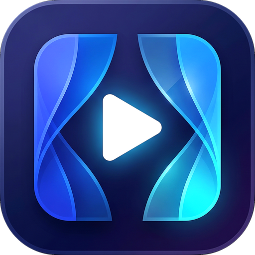

# Pardeh

A media player for **Windows 10 / 11** and **Android** that brings back the look of classic players, with a modern engine
underneath. Classic Windows Media Player (`.wmz`) and Winamp (`.wsz`) skins load natively, and the built-in looks are drawn
by Pardeh in code.

> Pardeh (پرده) means *screen* and, in Persian music, a *tone*: what you watch and what you hear.

[**Download**](#download) · [Looks](#looks) · [Features](#features) · [Build from source](#build-and-run)

## Download

Packages are on the [**Releases**](https://github.com/behradbhrmi/Pardeh/releases) page. If it is empty, no release has been
published yet: [build from source](#build-and-run).

| System | File | Notes |
|---|---|---|
| Windows 10 / 11 (x64), installer | `Pardeh-<version>-win-x64-setup.exe` | Includes .NET and needs no administrator rights. Take this one if unsure. |
| Windows 10 / 11 (x64), standalone | `Pardeh-<version>-win-x64-standalone.zip` | Includes .NET: nothing else to install. |
| Windows 10 / 11 (x64), small | `Pardeh-<version>-win-x64.zip` | A smaller download that needs the [.NET 11 Desktop Runtime](https://dotnet.microsoft.com/download/dotnet/11.0). |
| Android 7.0+ (arm64) | `Pardeh-<version>-arm64-v8a.apk` | Allow installing from your browser or file manager. A release has this file only when the Android signing key was set up. |

The installer is not code signed, so Windows SmartScreen may warn about it: choose **More info > Run anyway**.
For either Windows zip: unzip, then run `install.ps1` (no administrator rights) or just start `Pardeh.exe`.
`SHA256SUMS.txt` in each release lists the checksums. **About > Check for updates** in the app tells you when a newer
release is out; it contacts GitHub only when you ask.

## Looks

On Windows, pick one in **View > Full Mode Look** or **Tools > Options > Player**. On Android, use **Settings > Skins**.
The previews play made-up demo tracks. All of them were rendered on Windows; the phone looks use the same interface code on
Android, but the pictures are not captures from a device.

### Windows

#### Windows Media Player 9 (imported)

Pardeh can also run the original 2003 full mode, read from Windows XP files **of your own** ([how it works](#skins)).
Pardeh does not ship those files; without them, *Pardeh Classic* below is Pardeh's own drawing of this look.

<a href="docs/previews/windows/wmp9-imported.jpg">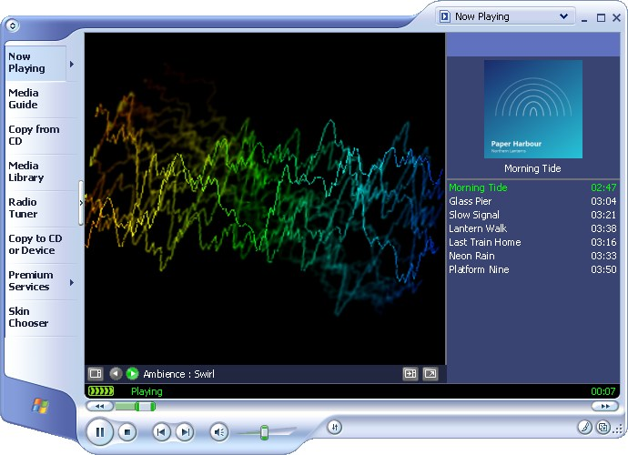</a>

<sub>This screenshot shows artwork of Windows Media Player 9 and the Windows logo, © Microsoft Corporation. It is shown only
to illustrate the import feature, is not part of Pardeh and is not covered by Pardeh's license.</sub>

#### Pardeh's own looks

<table>
<tr>
<td align="center" valign="top"><a href="docs/previews/windows/pardeh.jpg">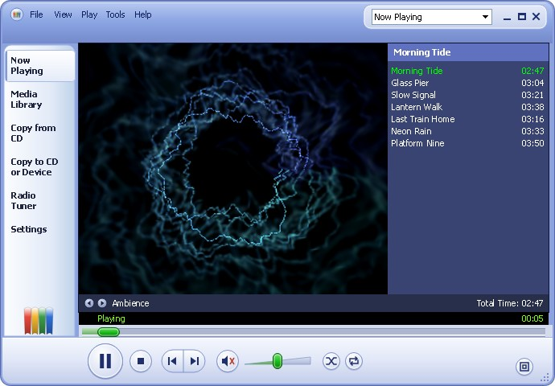</a><br>Pardeh Classic</td>
<td align="center" valign="top"><a href="docs/previews/windows/horizon.jpg">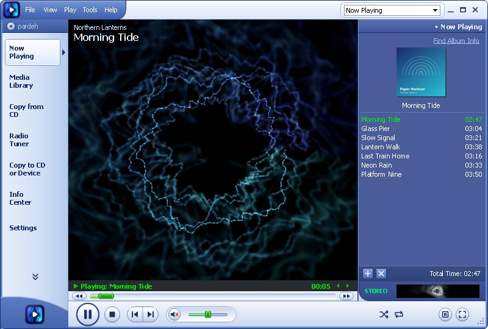</a><br>Horizon</td>
<td align="center" valign="top"><a href="docs/previews/windows/luna.jpg">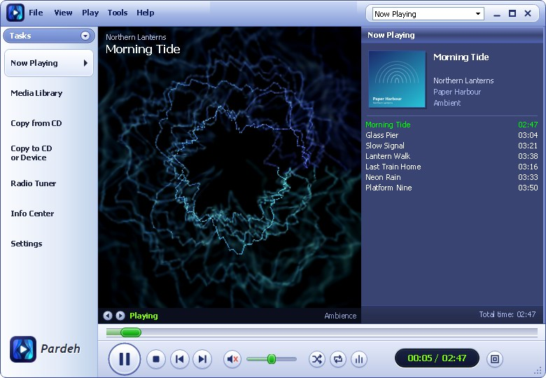</a><br>Luna</td>
</tr>
<tr>
<td align="center" valign="top"><a href="docs/previews/windows/fluent.jpg">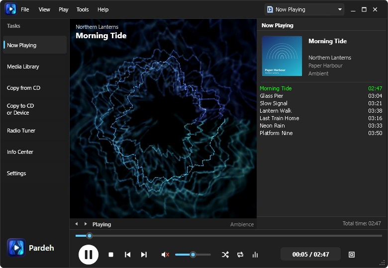</a><br>Fluent</td>
<td align="center" valign="top"><a href="docs/previews/windows/ember.jpg">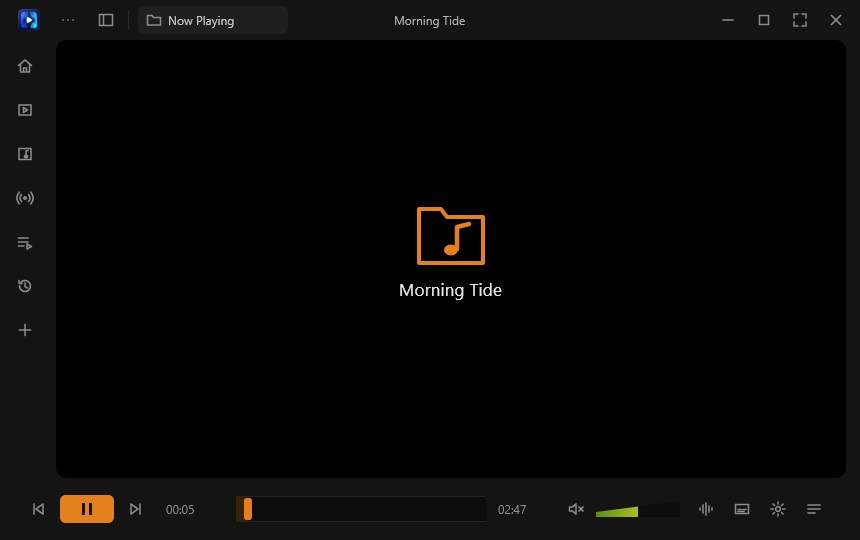</a><br>Ember</td>
<td align="center" valign="top"><a href="docs/previews/windows/aero10.jpg">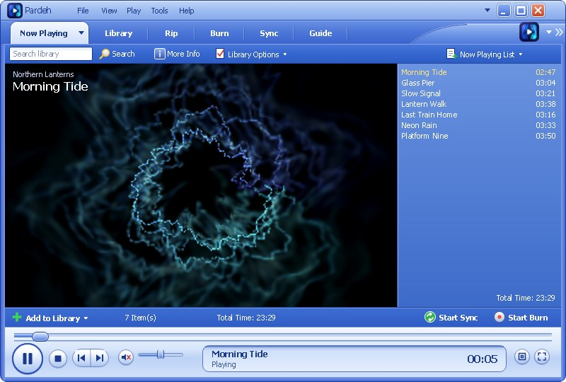</a><br>Pardeh Ten</td>
</tr>
<tr>
<td align="center" valign="top"><a href="docs/previews/windows/zune.jpg">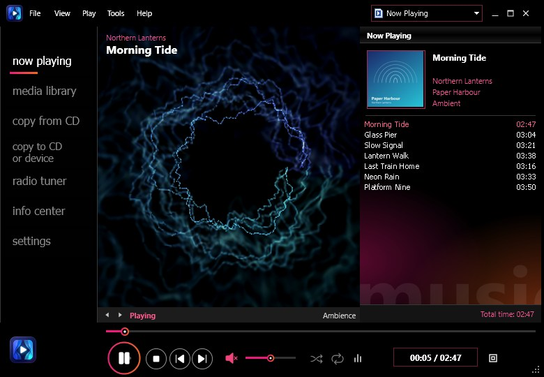</a><br>Zune HD (PC)</td>
<td align="center" valign="top"><a href="docs/previews/windows/wm6.jpg">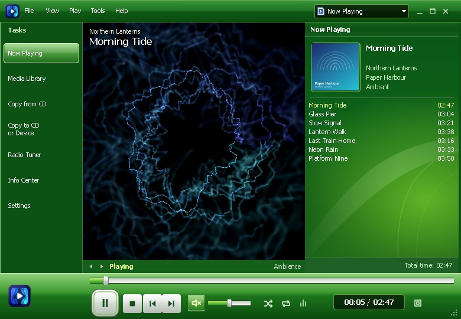</a><br>Windows Mobile 6 (PC)</td>
<td align="center" valign="top"><a href="docs/previews/windows/metro.jpg">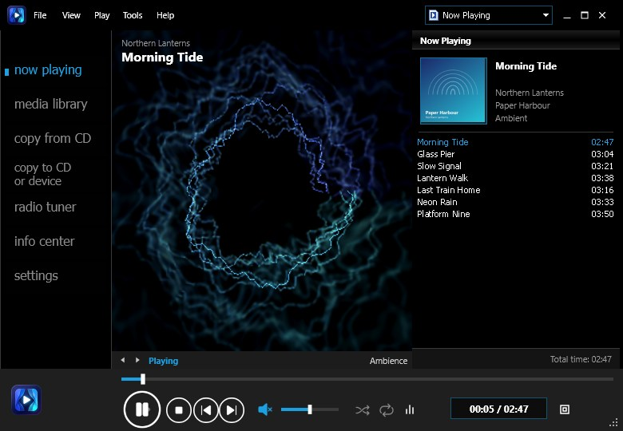</a><br>Windows Phone 7 (PC)</td>
</tr>
<tr>
<td align="center" valign="top"><a href="docs/previews/windows/kin.jpg">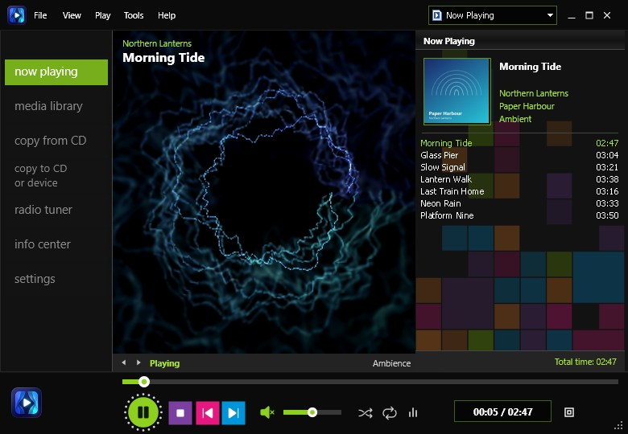</a><br>Kin Two (PC)</td>
<td align="center" valign="top"><a href="docs/previews/windows/blades.jpg">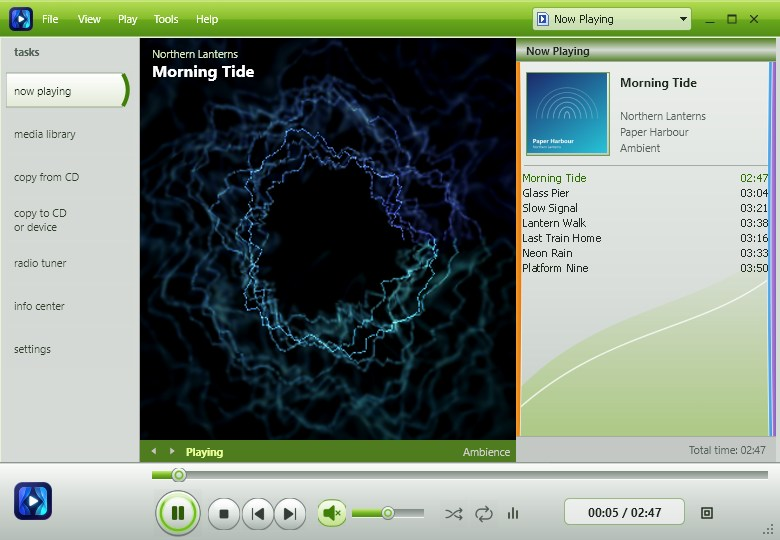</a><br>Xbox 360 Blades (PC)</td>
<td align="center" valign="top"><a href="docs/previews/windows/xbox.jpg">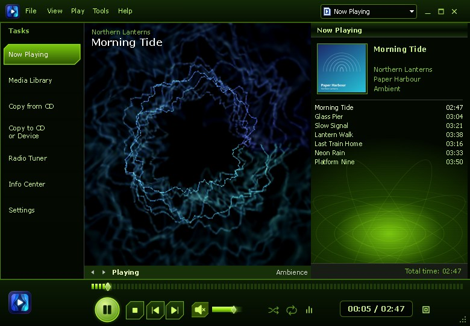</a><br>Xbox Classic (PC)</td>
</tr>
<tr>
<td align="center" valign="top"><a href="docs/previews/windows/walkman.jpg">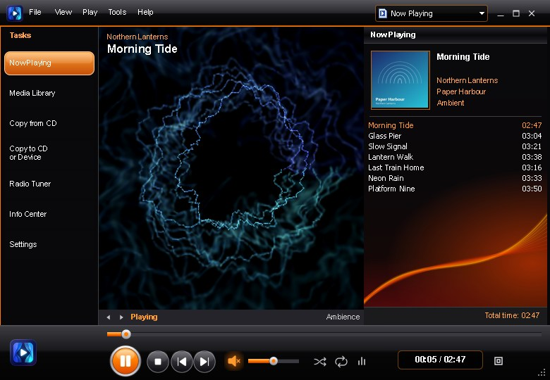</a><br>Walkman Orange (PC)</td>
<td align="center" valign="top"><a href="docs/previews/windows/winamp.jpg">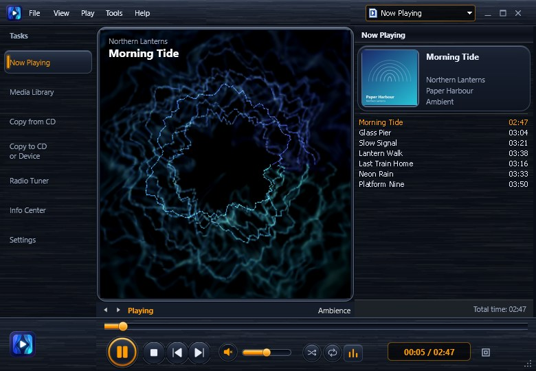</a><br>Winamp (PC)</td>
<td align="center" valign="top"><a href="docs/previews/windows/groove.jpg">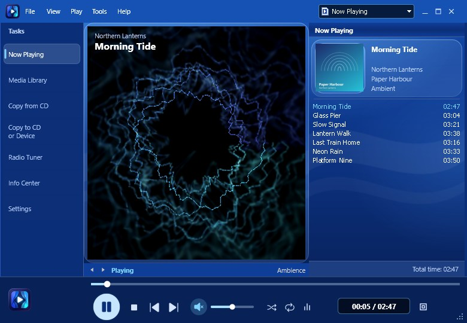</a><br>Groove (PC)</td>
</tr>
</table>

### Android

<table>
<tr>
<td align="center" valign="top"><a href="docs/previews/android/luna.jpg">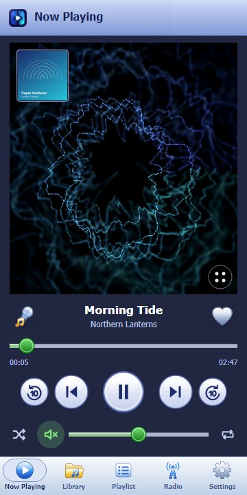</a><br>Luna Phone</td>
<td align="center" valign="top"><a href="docs/previews/android/luna-plus.jpg">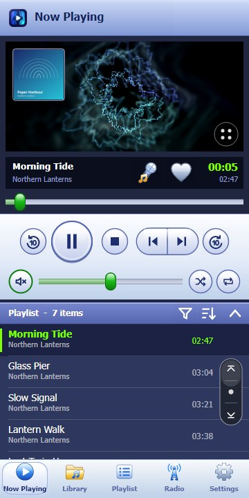</a><br>Luna Phone Plus</td>
<td align="center" valign="top"><a href="docs/previews/android/fluent.jpg">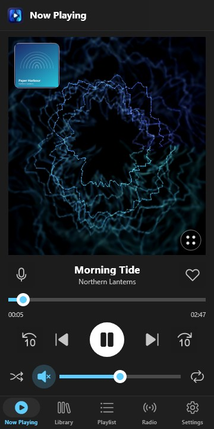</a><br>Fluent Phone</td>
<td align="center" valign="top"><a href="docs/previews/android/ember.jpg">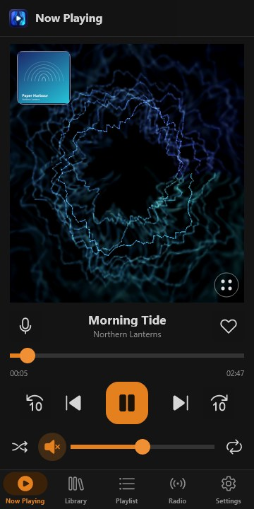</a><br>Ember Phone</td>
</tr>
<tr>
<td align="center" valign="top"><a href="docs/previews/android/horizon.jpg">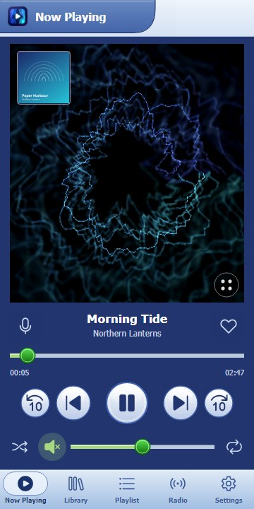</a><br>Horizon Phone</td>
<td align="center" valign="top"><a href="docs/previews/android/aero10.jpg">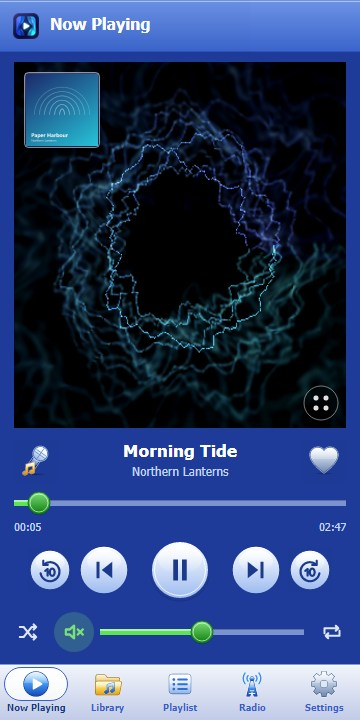</a><br>Pardeh Ten Phone</td>
<td align="center" valign="top"><a href="docs/previews/android/glass.jpg"></a><br>Pardeh Glass</td>
<td align="center" valign="top"><a href="docs/previews/android/winamp.jpg">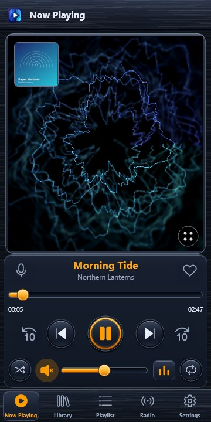</a><br>Winamp Phone</td>
</tr>
<tr>
<td align="center" valign="top"><a href="docs/previews/android/groove.jpg">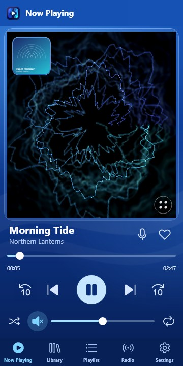</a><br>Groove Phone</td>
<td align="center" valign="top"><a href="docs/previews/android/wm6.jpg">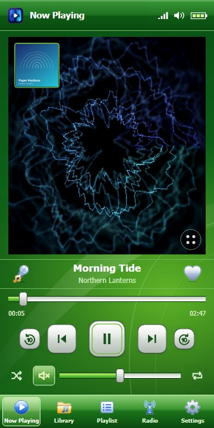</a><br>Windows Mobile 6</td>
<td align="center" valign="top"><a href="docs/previews/android/metro.jpg">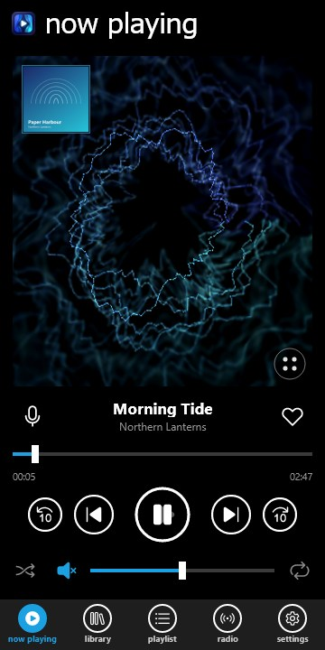</a><br>Windows Phone 7</td>
<td align="center" valign="top"><a href="docs/previews/android/zune.jpg">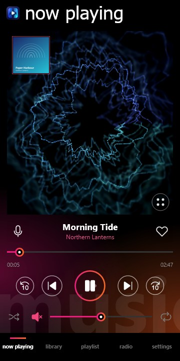</a><br>Zune HD</td>
</tr>
<tr>
<td align="center" valign="top"><a href="docs/previews/android/kin.jpg">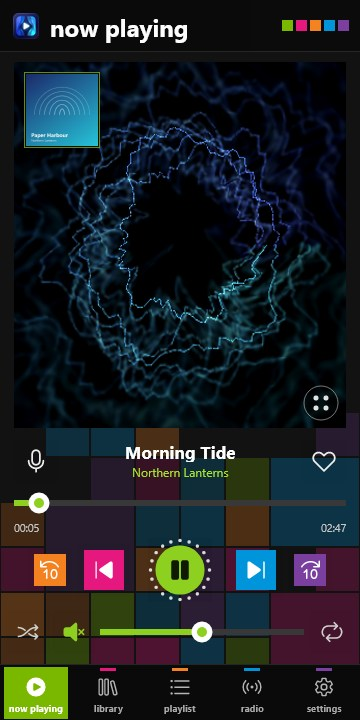</a><br>Kin Two</td>
<td align="center" valign="top"><a href="docs/previews/android/blades.jpg">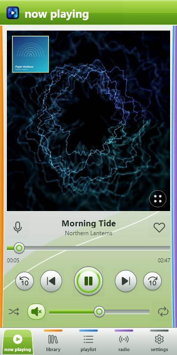</a><br>Xbox 360 Blades</td>
<td align="center" valign="top"><a href="docs/previews/android/xbox.jpg">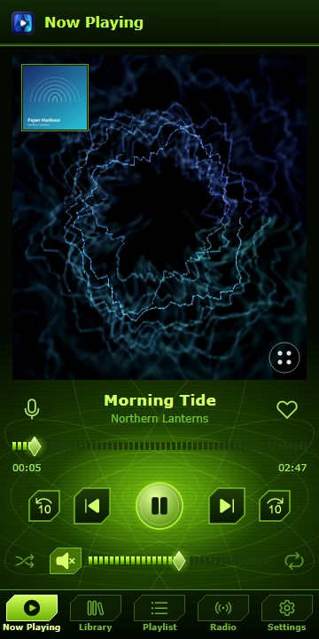</a><br>Xbox Classic</td>
<td align="center" valign="top"><a href="docs/previews/android/walkman.jpg">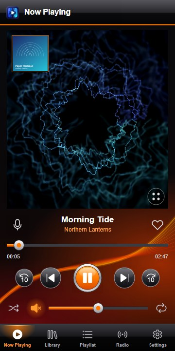</a><br>Walkman Orange</td>
</tr>
</table>

### Colours

**Pardeh Glass** can be recoloured: **Settings > Appearance** has these nine presets, plus hue, saturation and brightness
sliders. The Pardeh logo can follow the colour too.

<table>
<tr>
<td align="center" valign="top"><a href="docs/previews/colors/glass-royal.jpg">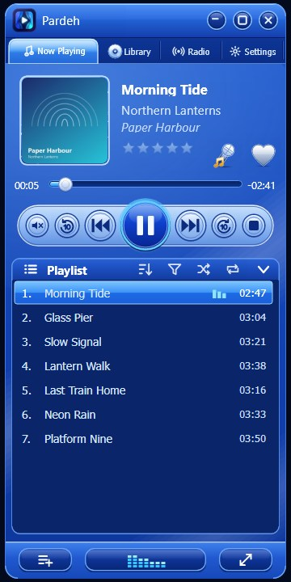</a><br>Royal blue</td>
<td align="center" valign="top"><a href="docs/previews/colors/glass-teal.jpg">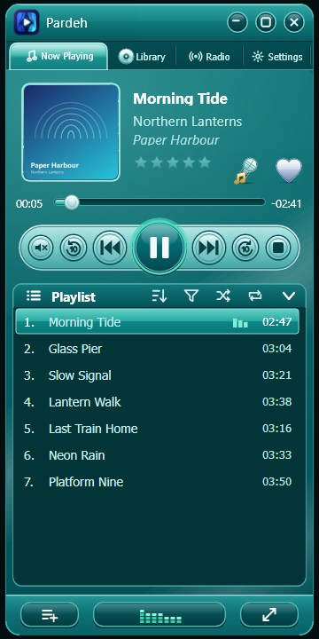</a><br>Teal</td>
<td align="center" valign="top"><a href="docs/previews/colors/glass-emerald.jpg">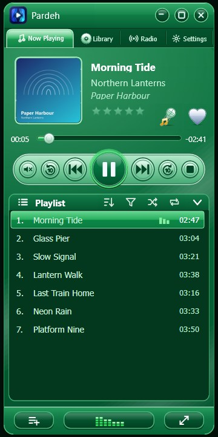</a><br>Emerald</td>
<td align="center" valign="top"><a href="docs/previews/colors/glass-amber.jpg">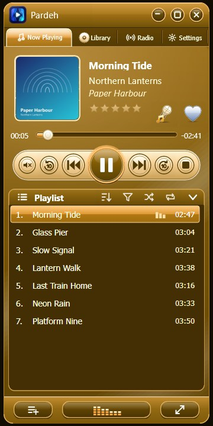</a><br>Amber</td>
<td align="center" valign="top"><a href="docs/previews/colors/glass-orange.jpg">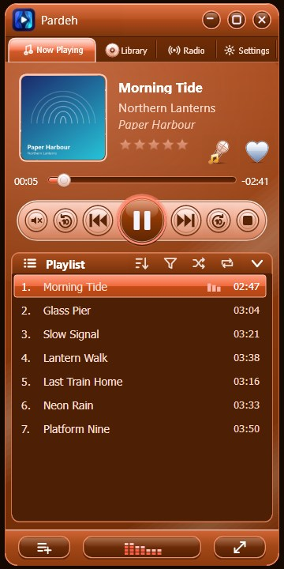</a><br>Orange</td>
</tr>
<tr>
<td align="center" valign="top"><a href="docs/previews/colors/glass-crimson.jpg">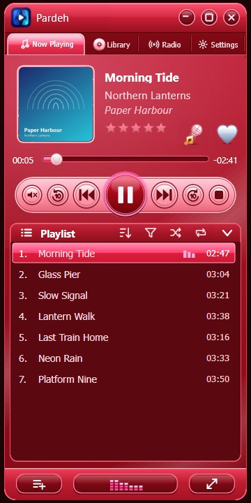</a><br>Crimson</td>
<td align="center" valign="top"><a href="docs/previews/colors/glass-rose.jpg">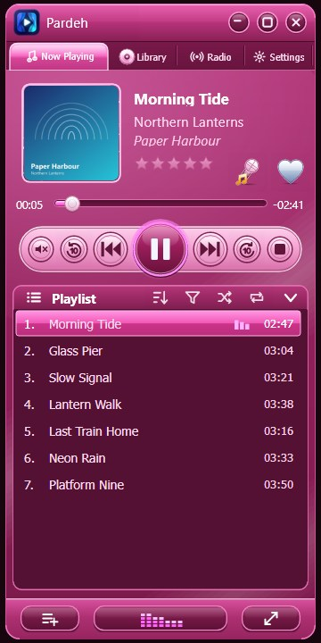</a><br>Rose</td>
<td align="center" valign="top"><a href="docs/previews/colors/glass-violet.jpg">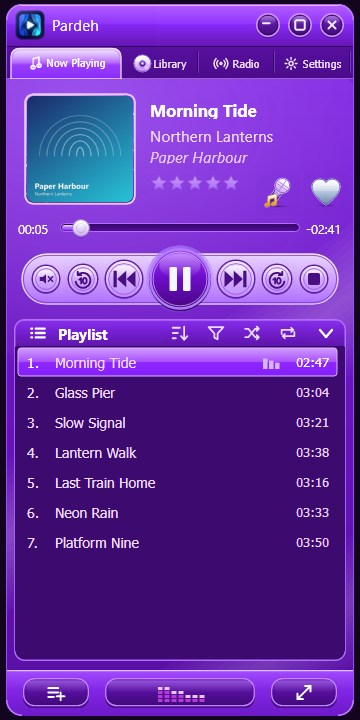</a><br>Violet</td>
<td align="center" valign="top"><a href="docs/previews/colors/glass-graphite.jpg">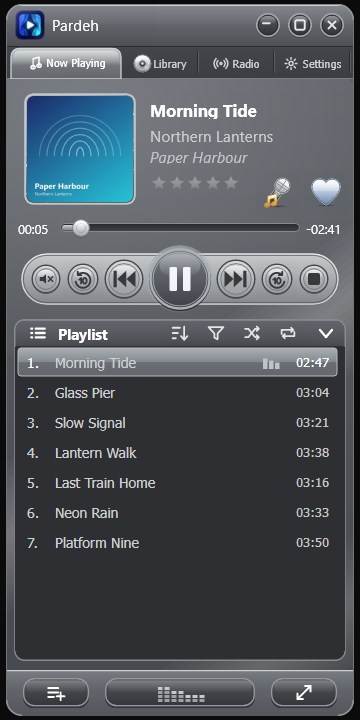</a><br>Graphite</td>
<td></td>
</tr>
</table>

## Features

### Playback

- Audio by **Nava** and video by **Nama**, Pardeh's own parts: FFmpeg decoding, with Windows Media Foundation as a fallback on
  Windows.
- 10-band equalizer with presets, balance, and visualizations.
- Gapless playback for audio files with the same sample rate, and crossfade.
- Volume levelling from ReplayGain tags; untagged files are measured in the background.
- Sleep timer, A-B repeat, named markers on the seek bar, play speed, and resume for longer videos.
- Video with embedded and external subtitles, subtitle delay and aspect ratio settings.

### Online media

- Open or drop the address of a media file or stream: HTTP(S) and HLS, plus protocols such as RTSP, RTMP and SRT that the
  FFmpeg build supports.
- Choose the online video quality for HLS (360p to 1080p; 720p by default). Dropped connections are retried.
- A web page's address plays **only** when the page itself publishes the address of its video. Many sites, YouTube among
  them, do not.
- Addresses that contain a password or token are not saved in lists or written to the log.
- DASH is weak: some streams open slowly or do not resume after seeking.

### Library and queue

- Library by artist, album, genre and year; sorting, filters and favourites.
- Queue tools: sort, reverse, shuffle, remove duplicates, filter. The last queue comes back paused.
- Playlists, including downloaded `.m3u`, `.pls`, `.asx`, `.xspf` and `.wpl` lists of network addresses.

### Fix Info

- Cleans up downloaded songs, one at a time or the whole library: website text in tags and covers, names read from file
  names, and file renaming by a pattern of yours (off by default). You see every change first, and can undo it.
- These checks run on your device. Songs that need a look are marked in the library.
- You can also look up details and covers online. This is **off** until you turn it on. It sends a song's title and
  artist (or words from the file name) to [MusicBrainz](https://musicbrainz.org), with the app's name, version and this
  project's address. Covers come from the [Cover Art Archive](https://coverartarchive.org) on the Internet Archive; they
  belong to their owners.
  - **One song:** only when you ask.
  - **Check Library Online:** started by you, after it says how many songs it will send and roughly how long it takes and
    how much data it uses. You can pause or stop it; what it found is saved. Strong matches are ticked, the rest are
    reviewed one at a time, and nothing changes until you have seen a summary. Covers are downloaded only if you tick
    them, for the songs you apply. A large library takes hours: MusicBrainz allows about one request a second.
  - **Check the playing song:** a second setting, also **off**. A song that plays for a few seconds is looked up by
    itself, once. Nothing is changed.
- A blue mark shows a song with a match found online, an amber one a song that needs cleaning up.
- A match has a **Where to get it** button: see below.

### Online search and downloads

**Search Online**, **Looked-Up Songs** and **Downloads** are in the app menu. Online look-ups and downloads have separate
switches, both **off** until you turn them on.

- **Search Online** looks for any song by title and artist, in your library or not. The words you type go to MusicBrainz.
- **Where to get it** asks MusicBrainz for the pages it lists for a match: free download pages, shops and streaming
  services. It asks only when you press it. Anyone can edit MusicBrainz, so a listed link is no promise, and no links does
  not mean a song is not sold. A link opens in your browser (`https` only, after you have seen the site's name). Pardeh
  downloads nothing from those pages.
- **Looked-Up Songs** is the history of your look-ups and searches, with what they found. It is kept **on your device
  only**, up to 5,000 entries, and is on by default once you use online look-ups. You can filter it, look something up
  again, delete one entry or clear it all. Turning **Keep a history of look-ups** off deletes it. Opening it sends nothing.

**Downloads** are for audio files only, and each one is asked about first. There are two ways:

- **Free files from [Wikimedia Commons](https://commons.wikimedia.org):** classical, public-domain and openly licensed
  work, and little popular music. The words you type are sent to Commons, and files come from Wikimedia's file server;
  both get the app's name, version and this project's address. A download is offered only for a file with a licence
  Pardeh recognises as permitting it. You see the author, licence and source first, and the app's list of downloads keeps
  them. The licence and source are also written into the file where it has room for them (never into a No-Derivatives
  file). These details are as Commons' contributors state them: Pardeh can't guarantee them.
- **A pasted link:** the address of an audio file, downloaded as a browser would download it. **Pardeh can't tell whether
  you may download it; that is for you to be sure of**, and no licence is recorded. The request goes to the host in the
  link as `Pardeh/1.0` (Wikimedia hosts get the version and project address too).
  - Only `https` addresses of public web sites, on the standard port. Addresses of your device or local network are
    refused, also after a redirect.
  - A web page is never searched for files. Playlists and stream manifests are refused.
  - Links to video and streaming services, such as YouTube, SoundCloud or Spotify, are refused, and Pardeh takes no audio
    out of them. The list of services is fixed, so it can't be complete.
  - Some VPN and tunnel apps answer every name look-up with a stand-in address (`198.18.0.0/15`), which Pardeh accepts
    for a name. Behind such a tunnel, or a system proxy, Pardeh can't check a site's real address.

No cookies, sign-ins, files or personal details are sent with a download or a search. As with any request, the host sees
your network address.

For every download:

- At most 200 MB, one at a time. The whole file is read with FFmpeg before it is added: it must be complete audio with no
  moving picture, and match the checksum where Commons gives one. Without FFmpeg there are no downloads.
- Files go to **Pardeh Downloads** in your Music folder on Windows, and to **Music/Pardeh** on Android, then into the
  library. Nothing is overwritten.
- You can pause, resume or cancel. Resuming continues where it stopped if the server allows it and its file has not
  changed. Downloads run only while Pardeh is open.

### Duplicates

- **Find Duplicates** (in the app menu) reads your songs on your device; nothing is sent anywhere. It starts only when
  you press Check, can be paused or stopped, and goes on where it was. On a phone it waits while the app is in the
  background.
- It keeps three kinds apart: **identical files**, the **same audio with different details**, and **probably the same
  recording** (same title, artists and version, length within 2 seconds). Remixes, live takes, instrumentals and other
  versions are never counted as duplicates. "Probably" is decided by names and length, not by listening.
- For each group you can keep one copy and take details or the cover from the others, remove the others, hide them from
  the library, or say they are not duplicates. A suggestion comes with its reason, and there is none when it is unclear.
  A higher stated bitrate is no proof of better sound.
- **Keep the best of each** works only on groups with the same audio, and shows every file it would keep and remove first.
- One copy always stays. One file reached two ways (overlapping folders, links) is never treated as two copies, and a file
  that can't be shown to be a separate one is not removed.
- Removed files go to the Recycle Bin or the system trash. Where there is none, they go to a "Pardeh Removed" folder,
  listed under **Removed Files**, which is only emptied when you say so. Playlists, ratings and play counts move to the
  copy you keep, and you can undo. On Windows, restore files from the Recycle Bin first, then choose Undo.
- **Find Copies and Similar**, in a song's menu, lists its copies, other versions and songs with close names, saying why.

### Lyrics, chords and tabs

- Timed or plain lyrics from tags, from files next to the song, or typed in yourself, with right-to-left text.
- Chords above the words (ChordPro) with transposing, and guitar tabs.
- Optional online lookup through LRCLIB, **off** until you turn it on.

### On Windows

- Full mode and skin mode, three window styles, lyrics over the picture or in their own window.
- Keymap profiles: VLC's keys by default (here the plain arrows also seek and set the volume), a Windows Media Player
  style set, or your own, with import and export. See [keyboard shortcuts](docs/17-keyboard-shortcuts.md).
- Double-click the picture for full screen; a right-click there opens the menu. In Pardeh's own looks, drag the edge of
  a playlist or side panel to resize it, and double-click the edge for its usual width.
- A desktop mini player, media keys and file type registration.
- A Windows 11 Widgets board widget can be built from source (`scripts/build-widget.ps1`); the release packages leave it out.

### On Android

- Media session and notification controls, an optional custom notification card, and a customisable home-screen widget.
- Device music and folders you pick; links shared or opened from other apps.
- Swipe between pages, playback tools sheet, landscape layouts.
- Releases are tested far less on real phones than the Windows app: please report what you find.

Not built: Copy from CD, Copy to CD or Device, and the Radio Tuner.

## Skins

- **Windows Media Player 7 to 11 `.wmz` / `.wms`:** layout, bitmaps, colour-key transparency, buttons, sliders, text,
  playlist, equalizer, slide-out panels and view switching. Skin scripts run in a sandboxed engine (Jint) against a
  WMP-compatible object model. See the [format notes](docs/03-wmz-skin-format.md).
- **Winamp 2.x classic `.wsz`:** the main window only (no equalizer or playlist window, no `region.txt` shapes).
- Drag a skin onto the player to switch to it. It is copied to `%APPDATA%\Pardeh\Skins`.
- **Original 2003 full mode:** `File > Import from Windows XP…` reads it from a Windows XP copy of your own. The imported
  files stay on your PC.

Pardeh ships no Microsoft, Winamp or other third-party skins. The skin loaders are plug-ins; see the
[architecture](docs/04-theme-plugin-architecture.md).

## Build and run

Needs the .NET 11 SDK. Built with Avalonia 12.1.5 (Skia). For every audio and video format on Windows, fetch FFmpeg once
(an LGPL build, not committed); without it Pardeh uses Windows Media Foundation (MP3, WMA, WAV, AAC, FLAC, MP4, WMV …).

```powershell
.\scripts\get-ffmpeg.ps1
dotnet build src/Pardeh.App
dotnet run --project src/Pardeh.App -- path\to\Skin.wmz [media files...]
```

With no skin argument Pardeh opens its full mode, or the last skin you used. Building the whole solution (`Pardeh.slnx`)
also builds the Android app, which needs the Android tools: see [building for Android](docs/android-build.md).

To leave **Download from a link** out of a build, for example for a store whose rules it may not meet, add
`-p:PardehLinkDownloads=false`. This removes the paste box; downloads from Wikimedia Commons and the shared download code
stay.

**Package for Windows** (a zip in `dist\`; add `-Standalone` for the package that includes .NET, or `-Installer`
for that package and a setup program, which needs [Inno Setup](https://jrsoftware.org/isinfo.php) 6.6 or newer):

```powershell
.\scripts\publish.ps1 -Version 1.0.0 -SkipWidget
```

**Tests** (use `dotnet run`; `dotnet test` does not work with this test runner):

```powershell
dotnet run --project tests/Pardeh.Skinning.Tests
```

Tests that need reference skins, FFmpeg or the internet are skipped when those are missing or not enabled.

**Releases** are built by GitHub Actions when a version tag is pushed: see [releasing](docs/releasing.md).

## Projects

| Project | Purpose |
| --- | --- |
| `Pardeh.Core` | Player model: playlist, transport, library, lyrics, keymaps, network addresses; Fix Info, duplicates, online look-ups and downloads |
| `Pardeh.Nava` | Audio: decoding, play speed, equalizer, effects, gapless and crossfade, spectrum, output (WASAPI, AudioTrack) |
| `Pardeh.Nama` | Video: decoding, each picture at its time, the video clock, subtitles inside video files |
| `Pardeh.Engine` | The playback engine: puts Nava and Nama together and keeps them in step; network and web page addresses |
| `Pardeh.Ffmpeg` | What both need of FFmpeg: loading the libraries, file, content and network input, the https relay |
| `Pardeh.Skinning` | Skin loaders, element runtime, script host, WMP object model (no UI dependency) |
| `Pardeh.UI` | The shared interface and built-in looks |
| `Pardeh.App` | Windows desktop app |
| `Pardeh.Android` | Android app |
| `Pardeh.Widgets` | Windows 11 Widgets board provider |

## Diagnostics

Environment variables for development:

- `PARDEH_SNAPSHOT=out.png` (and `PARDEH_SNAPSHOT_DELAY=seconds`): renders the window to a PNG after start, without needing focus.
- `PARDEH_SNAPSHOT_MENU=View` or `PARDEH_SNAPSHOT_DIALOG=options/2` (or `about`), with `PARDEH_SNAPSHOT`: renders a menu or dialog.
- `PARDEH_FULLMODE=<look>`: forces a look for one run, for example `luna`, `zune` or `glass-phone`.
- `PARDEH_GLASS_TINT=amber`: forces a Pardeh Glass colour.
- `PARDEH_DATA_DIR=folder`: uses this folder instead of `%APPDATA%\Pardeh`.
- `PARDEH_LIBRARY_FOLDERS=a;b`: scans these folders instead of Music and Videos.
- `PARDEH_DOWNLOAD_DIR=folder` (Windows): saves downloads here instead of **Pardeh Downloads** in the Music folder.
- `PARDEH_MUTE=1`: starts muted. `PARDEH_NO_FFMPEG=1`: uses the Media Foundation decoders. `PARDEH_DIAG=1`: logs player state.
- Log file: `%APPDATA%\Pardeh\pardeh.log`.

## Third-party libraries

- **.NET:** the standalone Windows package and the Android app include the .NET runtime (MIT); the standalone package
  carries its license and notices.
- **.NET packages:** Avalonia, FFmpeg.AutoGen and NAudio (MIT), Jint (BSD-2-Clause), TagLibSharp (LGPL-2.1). The optional
  Windows 11 widget also uses the Windows App SDK, under Microsoft's license.
- **Icons:** some come from Microsoft's Fluent UI System Icons (MIT).
- **FFmpeg** is used as dynamically loaded shared libraries under the LGPL; Pardeh does not modify it. Windows:
  [BtbN builds](https://github.com/BtbN/FFmpeg-Builds) (`scripts/get-ffmpeg.ps1`). Android: LGPL-3.0 builds from
  [tqk2811/FFmpegBuild](https://github.com/tqk2811/FFmpegBuild) (`scripts/get-ffmpeg-android.ps1`). The source is at
  [ffmpeg.org](https://ffmpeg.org/download.html). You can replace the libraries with your own build.

## Design credits

- **Ember** adapts the design of the [VLC Redesign by Juxtopposed](https://www.juxtopposed.com/), licensed
  [CC BY 4.0](https://creativecommons.org/licenses/by/4.0/). Pardeh's version is redrawn; it uses no VLC code, artwork or
  trademarks.
- **Horizon** follows the layout of the community
  [Windows Media Player 9 web app clone](https://github.com/rmellis/Windows-Media-Player-9-WebApp-Clone); its art is
  Pardeh's own.
- The Pardeh logo is AI-generated art. A personal logo can be used locally by placing `logo.png` in `%APPDATA%\Pardeh`.

## License

Pardeh is free software under the [GNU General Public License, version 3](LICENSE). If you distribute it, or an app built on
its code, you must provide the source under the same license. It comes with no warranty. Third-party libraries and designs
keep their own licenses (above). The license does not cover Microsoft's artwork in
`docs/previews/windows/wmp9-imported.jpg`.

Pardeh is an independent project. It is not affiliated with or endorsed by Microsoft, Winamp, Sony or any other company
whose products inspired a look. Their names and trademarks belong to their owners.
