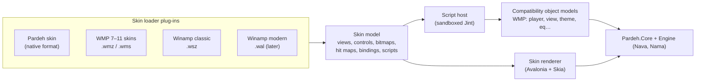

# Pluggable themes and skins

Decided 2026-11-04: Pardeh's look is fully pluggable. Every skin format is a **loader plug-in** that turns its files into one shared, engine-neutral skin model. The core never knows which format a skin came from.

## Formats and how far we can go

| Format | What it is | Feasibility | Notes |
| --- | --- | --- | --- |
| **Pardeh skin** | Our own format (WMS-like XML + PNG + JS) | Full | Default skins ship in this format, including the open-source Luna-style full mode |
| **WMP 7–11 skins** (.wmz) | XML + BMP + JScript | High | Same format family as 9SeriesDefault. Most skins should work once the WMP object model is emulated; a few that use rare or internal features may only partly work |
| **WMP Color Chooser** | Hue/saturation shift of the current skin | Full | A renderer feature, applied to any skin |
| **Winamp 2.x classic** (.wsz) | ZIP of fixed-layout BMPs + text configs | High | **Implemented 2026-11-17** (main window; see "Winamp classic loader" below). The Webamp project proves the format is reproducible |
| **Winamp 3/5 modern** (.wal) | XML + MAKI bytecode scripts | Medium (low for full fidelity) | Needs a MAKI interpreter; a later, optional plug-in. Design note below |
| **WMP visualization plug-ins** (native .dll) | 32-bit COM DLLs | Low | Windows-only; would need a 32-bit helper process. Not planned |
| **MilkDrop presets** (.milk) | Classic visualization presets | High | Via projectM; a separate visualization plug-in type |

## Rules

- **Plug-in contract:** `ISkinLoader` (name, extensions, `Load(path)` → `SkinPackage`) in `Pardeh.Skinning/Model/SkinLoaders.cs`, plus the `SkinLoaders` registry (`Find`, `Load`, `IsSkinFile`, `PickerPatterns`, `Register`). The shared skin model is `SkinPackage` (a THEME/VIEW element tree plus in-memory files), which the renderer, hit testing, window shape and scripts already consume; `IScriptObjectModel` (exposes `player`, `view`, … to scripts) is what the WMP object model implements. Built in: `WmpSkinLoader` (.wmz, .wms) and `WinampClassicLoader` (.wsz). They live in `Pardeh.Skinning` for now (Android shares them); splitting them into their own assemblies stays possible because the host only talks to the registry. Every host entry point goes through it: command line and drag-and-drop (`StartupOptions.IsSkinFile`), Skin Chooser list and previews, the Choose skin dialog, the skin library folder.
- **Skins are untrusted downloads.** Scripts run in a sandboxed Jint engine: no file, network or process access beyond the object model, with time and memory limits. Archives are checked for unsafe paths and size limits on extraction. `player.launchURL` and similar calls ask the user first.
- **Repo ships no third-party skins.** Users install their own (drag a .wmz/.wsz onto Pardeh or use the Skin Chooser). Microsoft and Winamp assets are never committed.
- **Cross-platform:** loaders, renderer and script host are pure .NET, so skins work on Android too. Hover states fall back to press states on touch.

## Order

1. Skin model + renderer + WMP loader, proven on `private/skins/9SeriesDefault.wmz`.
2. Pardeh native format; the Luna-style full mode authored in it.
3. Skin Chooser (install, preview, switch, Color Chooser).
4. Winamp classic loader (done 2026-11-17).
5. Later, optional: Winamp modern (.wal), a documented Pardeh-native skin format, MilkDrop visualizations.

## Winamp classic loader (.wsz), implemented 2026-11-17

`Pardeh.Skinning/Winamp/WinampClassicLoader.cs`. A `.wsz` is a ZIP of BMP sheets at fixed positions. The loader reads only the known file names (any letter case, also inside a sub-folder; nothing else is read, nothing is extracted to disk; 4096 entries and 8 MB per file at most), cuts each sheet into per-state images (re-encoded as 24-bit BMP files inside the in-memory package, `Imaging/BmpEncoder.cs`) and lays out the fixed **275 × 116** main window as an ordinary skin tree, so no engine code is Winamp-specific except two small opt-in elements.

| Winamp part | Mapped to |
| --- | --- |
| `main.bmp` + active title bar from `titlebar.bmp` | background SUBVIEW (a subview, not the view image, so dragging the background moves the window) |
| menu / minimize / close (`titlebar.bmp`) | BUTTONs (menu opens the File menu, minimize, close); the shade button is drawn but inert |
| prev / play / pause / stop / next (`cbuttons.bmp`) | PREVBUTTON … NEXTBUTTON with pressed images; Play on an empty playlist opens the file dialog, as in Winamp |
| eject | BUTTON, open file dialog |
| shuffle / repeat (`shufrep.bmp`) | SHUFFLEBUTTON / REPEATBUTTON; the latched ("selected") image is shown while the mode is on |
| EQ / PL toggles | drawn, not clickable (no equalizer or playlist window) |
| time digits (`numbers.bmp`, else `nums_ex.bmp`) | two GLYPHTEXT elements (`mm`, `ss`) bound to the position |
| song title (`text.bmp`) | GLYPHTEXT with a marquee that scrolls titles wider than 154 px; shows `name (length)`, "PARDEH" when idle |
| play / pause / stop indicator (`playpaus.bmp`), mono / stereo (`monoster.bmp`) | SUBVIEWs bound to the play state (stereo lights while playing: no channel info yet) |
| volume / balance (`volume.bmp`, `balance.bmp`) | 28 background frames chosen by the value + VOLUMESLIDER / BALANCESLIDER with the sheet's thumbs |
| seek bar (`posbar.bmp`) | SEEKSLIDER, the thumb only shows while a track plays or pauses |
| spectrum area, `viscolor.txt` | ANALYZER bars (19 × 3 px, 16 rows) coloured row by row from the 24 viscolor entries |
| `pledit.txt` | parsed and kept as theme attributes (`winampPlaylistNormal` …) for a future playlist window |

New opt-in elements (never used by WMP skins): `GLYPHTEXT` (bitmap-font text from a sheet; `glyphSet` "text" or "digits") and `ANALYZER`, both in `Pardeh.Skinning/Runtime/Elements`, drawn by `SkinRenderer`. `BmpDecoder` gained RLE8 / RLE4 support, because real Winamp skins compress most of their sheets with RLE8.

**Not supported (honest list):** `region.txt` window shapes (the window stays a rectangle), the equalizer window (`eqmain.bmp`, `eq_ex.bmp`), the playlist window (`pledit.bmp`), the library / video / generic windows (`gen*.bmp`, `video.bmp`, `mb.bmp`), window-shade mode, double-size mode, the kbps / kHz readouts, remaining-time display (minus sign), the clutterbar buttons and the about click, custom cursors (`*.cur`), and truncated or non-standard sheets are skipped control by control (a skin missing `cbuttons.bmp` loads without transport buttons). Not registered as a Windows file type (Tools › Options › File Types lists `.wmz` only); drag, the command line and the Choose skin dialog work.

**Verification:** unit tests build a synthetic `.wsz` in code at the real sheet sizes (every sprite rectangle a unique colour; `tests/Pardeh.Skinning.Tests/WinampSkinTests.cs`) and check the cut positions, the control layout, the bindings, button behaviour, RLE8, bad archives, and a pixel-level render through the real renderer. Sprite coordinates are the classic skin spec, written from memory and checked once, by hand, against the real default Winamp 2.91 skin loaded from a scratch folder (never committed): the window rendered correctly idle and while playing (clock, marquee, analyzer, seek thumb, indicators). Other skins have not been tried; `Real_wsz_skins_in_the_private_folder_load_and_start` loads every `.wsz` in the git-ignored `private/skins` when present.

## Design note: Winamp modern skins (.wal), not implemented

**What it is.** A ZIP with `skin.xml` (plus included XML), bitmaps (PNG / BMP / JPG), fonts and compiled **MAKI** scripts (`.maki`). The XML defines containers, layouts, group definitions and elements (`button`, `togglebutton`, `slider`, `text`, `animatedlayer`, `layer`, `grid`, …) with `action="PLAY"`-style built-in bindings; MAKI is a typed bytecode (header, imported class GUIDs, function and variable tables, stack-machine opcodes) that handles the rest (menus, state, animations).

**Scope if done.** (1) XML parser and element mapping onto SkinNode (groups, includes, bitmap slices, `relatx` / `relaty` / `relatw` layout, alpha-mask regions that our shaped-window mask already supports); (2) a MAKI reader (disassembler) and stack-machine interpreter with a step limit; (3) the script object model (`System`, `Container`, `Layout`, `GuiObject`, `Button`, `Slider`, `Text`, `Timer`, `Map`, `Region`, `Menu` …: several hundred methods, event-driven, only the events skins actually use need to work); (4) text and bitmap fonts, truetype loading, scrolling text; (5) multiple windows: the engine runs one view at a time (view switching exists), while modern skins expect several linked containers (main, playlist, library, equalizer) on screen together.

**Risks.** Large, long-tail work (the interpreter and object model are the bulk: thousands of lines and a test corpus of real skins that cannot be committed); the format is only documented through old SDK notes and other players' source, so behaviour is learned by trial; skins differ widely (some only work with the whole Wasabi object model); untrusted bytecode needs instruction and memory limits and no I/O beyond the object model; Android needs the same code (pure managed, so fine) but touch layouts of desktop windows are poor. Licensing: code from other players cannot be copied without checking the licence; the format itself can be implemented from observed behaviour.

**Recommended minimal first step.** An XML-only `.wal` loader: parse `skin.xml`, build one layout (the main container's default layout) as static images plus buttons / sliders / text mapped through their `action=` attributes (`PLAY`, `PAUSE`, `STOP`, `PREV`, `NEXT`, `VOLUME`, `SEEK`, `SONGNAME`, `TIME`), and log that scripts are ignored. Many skins are usable that way for the transport, and it forces the right pieces (XML includes, bitmap slices, relative layout) before any interpreter exists. Then a read-only MAKI disassembler with tests on hand-made scripts, and only then the interpreter, driven by whichever events the first real skins need. Estimate: step 1 a few days, interpreter plus object model several weeks.

## Design note: a Pardeh-native skin format, not implemented

**What exists.** Every built-in full mode is already a WMS-style element tree plus PNG art and a little script, generated in code (`FullMode/*.cs`) and loaded through `WmzLoader.FromFiles`. The engine, the `pardeh` script object (opt-in commands) and the Skin Chooser already work on it. What is missing is a documented, versioned, external format authors can target without learning the WMP quirks.

**Scope.** A ZIP (`.pardeh-skin`) with a manifest (`skin.xml`: `<pardeh-skin version="1" id name author licence minPardeh>`), `layouts/*.xml` (desktop, phone portrait, phone landscape: the engine already has phone layouts), PNG art with real alpha (the decoder and `SkinBitmap` support it; `@2x` variants for high-DPI, nine-slice via `borderSize`), `scripts/*.js` against a documented, versioned `pardeh` object (player, queue, library, settings, theme colours), colour tokens with light and dark sets, string tables for localisation, optional TTF fonts (licence-checked). Tooling: `--dev-skin <folder>` (loose folder with file-watcher hot reload, mirroring the loose `.wms` loader), a packer and a linter that validates elements and attributes against a schema generated from the engine's `KnownProperties`.

**Risks.** The API becomes a compatibility promise (version it from day one and keep the WMP object model separate); scope creep into a general UI toolkit (keep to the element set the engine has, add elements only when a built-in mode needs them); two ways to do the same thing (WMS dialect vs native) unless the native format is explicitly "WMS minus the legacy" with an automatic converter for the built-in modes; untrusted scripts and archives need the same sandbox and limits as `.wmz` (they get them by going through the same loader and Jint host). Authoring in Avalonia XAML was considered and rejected: XAML can load types and run code, which a downloadable skin must never do, and it would not run on the shared renderer.

**Recommended minimal first step.** Write the format spec from what the built-in modes actually use (`docs/pardeh-skin-format.md`), add a `PardehSkinLoader` that is `WmzLoader` plus the manifest check and API version gate, add `--dev-skin <folder>` with hot reload, and export one built-in mode (Horizon: its art is generated, so an exporter writing PNGs and the layout is small) as an example skin loaded through the new loader, to prove that built-in and external skins are the same thing. About a week; the exporter and the spec are the real work.
